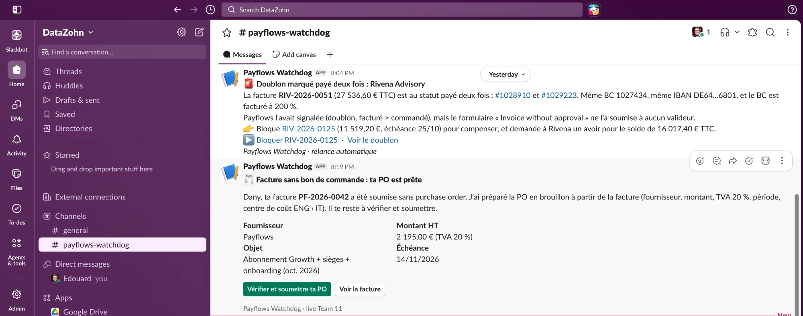
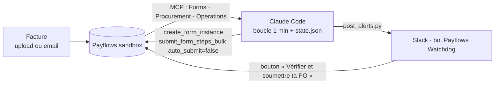
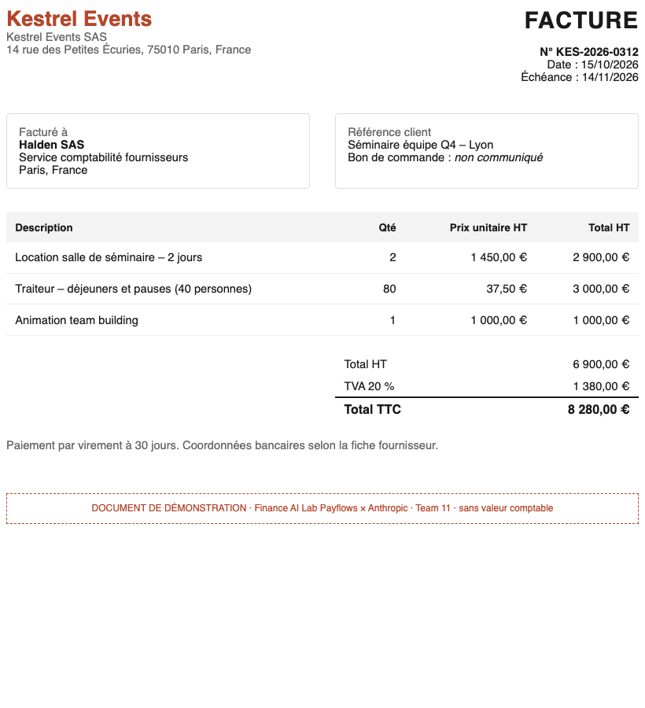

# Payflows Watchdog

### 🏁 Projet réalisé au [Finance AI Lab · Payflows × Anthropic](https://luma.com/payflows-w2ld), Paris, 15 octobre 2026

**Le contexte :** le Finance AI Lab est un mini-hackathon d'une soirée, avec environ 2 h de build. Des équipes mêlant directeurs financiers et *AI builders* y construisaient un agent qui prend en charge un processus finance encore fait à la main. Les outils fournis :
- **Payflows**, plateforme française de procure-to-pay (demandes d'achat, bons de commande, factures, circuits de validation), via un bac à sable et ses connecteurs MCP ;
- **Anthropic** : Claude, Claude Code et des crédits API.

**Team 11 :** Serge Da Silva (Ledger), Margot Scampini, Dany Srage (Defacto) et Edouard Foussier, avec le soutien d'Augustin (Payflows).

> Toutes les données présentées ici sont **fictives** : bac à sable de démonstration (entreprise « Halden SAS », fournisseurs et personas inventés) et dataset anonymisé fourni par les organisateurs. Ce dataset n'est pas inclus dans ce repo.

> Un agent Claude qui surveille Payflows et **relance la bonne personne dans Slack, au bon moment, avec ce qu'il faut pour agir**.
> Exemple : une facture arrive sans bon de commande → l'agent **prépare la PO en brouillon** à partir de la facture et envoie au demandeur un bouton « Vérifier et soumettre ta PO ». Payflows sait rejeter une facture sans PO ; nous, on prépare la PO, et le circuit ne s'arrête pas.



---

## 1. Le problème

Les circuits de validation ralentissent moins à cause des règles qu'à cause des **oublis** : une facture sans PO, une validation qui traîne, une réception jamais saisie. Les chiffres du dataset Northwind fourni par les organisateurs :

- **24 % des factures arrivent sans PO** (2 664 sur 11 010).
- **64 % des factures sont approuvées après leur échéance**, surtout parce qu'elles sont **saisies en retard** : parmi les factures saisies depuis juillet 2025, 3 278 ont été approuvées hors délai, et 3 030 d'entre elles étaient déjà échues à leur entrée dans Payflows.

## 2. Ce qu'on a construit

| Brique | Ce qu'elle fait | État |
|---|---|---|
| **Boucle Watchdog** | Toutes les minutes, lit les factures du bac à sable Payflows via MCP. Pour chaque nouvelle facture sans PO : crée la PO en **brouillon** (fournisseur, montant HT, TVA, période, entité, centre de coût suggéré) et poste l'alerte dans Slack. | ✅ Live pendant la démo |
| **App Slack « Payflows Watchdog »** | Bot (incoming webhook) dans `#payflows-watchdog`, messages avec boutons d'action. | ✅ |
| **Relances proactives** | Morning brief de la DAF, doublon marqué payé deux fois, validation en retard avec escalade, circuit de validation jamais activé, reconduction tacite de contrat. | ✅ Postées une fois, pas encore automatisées |
| **« L'agent apprend »** | Pistes d'allègement du circuit, calculées sur 12 769 décisions d'approbation historiques. | ✅ Message préparé |
| **Message planifié** | Pré-alerte de SLA programmée à 22:55 (9 factures franchissaient 24 h d'attente à 23:05). | ✅ Via le connecteur Slack |
| **Factures de démo** | 6 PDF cohérents avec le bac à sable : acheteur Halden SAS, vrais fournisseurs, TVA selon le pays (autoliquidation pour les fournisseurs UE/UK). | ✅ |

### Ce qui s'est passé en live

| Facture | Fournisseur | Montant HT | Comment elle est arrivée | Réaction de l'agent | PO |
|---|---|---|---|---|---|
| ALT-2026-1009 | Altiplano Software | 4 800 € | Déjà dans le bac à sable | Circuit fait à la main (premier test) | [PAYF-1035671](https://app.payflows.io/purchase-orders/1035671), soumise |
| JOR-2026-0148 | Jorvik Agency | 3 200 € | Déposée par Dany | Brouillon + alerte en ~2 min, avec un drapeau « doublon possible » | [PAYF-1035712](https://app.payflows.io/purchase-orders/1035712), soumise par Dany |
| PF-2026-0042 | Payflows | 2 195 € | **Envoyée par email** à l'adresse de collecte, puis soumise | Brouillon + alerte en moins d'une minute après soumission | [PAYF-1035722](https://app.payflows.io/purchase-orders/1035722), soumise à 20:37 |

## 3. Comment ça marche



- **Payflows** : les 3 connecteurs MCP officiels (Forms 25 outils, Procurement 29, Operations 34), branchés dans Claude Desktop / Claude Code avec un login Payflows.
- **Cerveau** : Claude dans une session Claude Code. Il n'y a pas de code d'orchestration : l'agent, c'est un prompt rejoué chaque minute par une tâche planifiée, voir [watchdog/LOOP_PROMPT.md](watchdog/LOOP_PROMPT.md).
- **Mémoire** : [watchdog/watchdog_state.py](watchdog/watchdog_state.py) garde la liste des factures déjà traitées dans `state.json` (jamais deux traitements, plafond de 5 brouillons).
- **Slack** : [watchdog/post_alerts.py](watchdog/post_alerts.py) poste en Block Kit via un incoming webhook. L'app se crée en 2 minutes avec [watchdog/slack_app_manifest.yml](watchdog/slack_app_manifest.yml). L'URL du webhook reste dans `watchdog/.env`, ignoré par git.
- **Outils MCP utilisés** : `retrieve_form_instances`, `query_approvals`, `get_form_instance_approval_workflow_status`, `create_form_instance`, `retrieve_all_form_steps`, `submit_form_steps_bulk`, `search_vendors`, `search_analytical_axis_nodes`, `search_people`, `frontend_link`, `retrieve_documentation`, `query_contracts`.



## 4. Les décisions qu'on a prises, et pourquoi

1. **Track B (bac à sable Payflows + MCP) plutôt que le dataset seul.** C'est là que Payflows et Anthropic se rencontrent sur un cas concret : de vraies factures, de vraies PO, de vraies actions.
2. **Sujet : « ne pas ralentir les workflows ».** On est partis de « surveiller les demandes de PO », puis on a resserré sur le cas le plus parlant : la facture sans PO.
3. **Préparer plutôt que signaler.** L'agent pré-remplit la PO avec les mêmes briques MCP que l'agent de pré-remplissage de Payflows (Apollo), mais à partir de la facture. Le demandeur n'a plus qu'à cliquer.
4. **Un humain dans la boucle, toujours.** L'agent ne soumet, n'approuve ni ne supprime jamais rien (`auto_submit=false`). Autres garde-fous : plafond de 5 brouillons, arrêt automatique à 21h, autorisation explicite pour chaque type d'action.
5. **Vérification chaque minute plutôt qu'un webhook.** Aucun webhook n'existe ni dans le MCP ni dans la doc Payflows.
6. **Slack en deux temps.** Le connecteur officiel a servi pour tester tout de suite. L'app bot a donné une vraie identité « Payflows Watchdog » et des boutons.
7. **Pas de données synthétiques en masse.** Le bac à sable est partagé avec les autres équipes : seulement quelques factures de démo, étiquetées comme telles.
8. **Des chiffres honnêtes.** Chaque anomalie a été revérifiée par un second agent. Exemple : les 35 commandes Pellam Media ressemblaient à un fractionnement, mais c'étaient les commandes de préparation du bac à sable (une par équipe). Retiré.

## 5. Ce qu'on a exploré sans avoir le temps de le brancher en live

**Autres anomalies, trouvées et vérifiées dans le bac à sable**
- 🚨 **Doublon payé deux fois** : Rivena RIV-2026-0051, 27 536,60 €. Payflows l'avait signalé, mais il est passé par le formulaire « Invoice without approval ».
- ⚠️ **Circuit jamais activé** : les approbateurs AP, contrôleur, DAF et centre de coût n'ont jamais reçu leur invitation. 12 factures (639 k€) bloquées.
- ⛔ **Auto-validation** : le demandeur a validé lui-même sa PO et sa facture Altiplano (deux étapes en 4 secondes).
- 📅 **Reconduction tacite** : le contrat Norvane (820 k€) se renouvelait le 25/10, préavis échu depuis le 25/07, contrat non signé.
- 🏦 **IBAN incohérent** : un fournisseur français payé sur un IBAN lituanien (108 k€), sans RIB au dossier.
- 📈 **Facture au-dessus de la PO** : +18 % chez Marlowe, déjà marquée payée.
- ✂️ **Découpage en phases** : 3 PO Fenwick créées en 3 secondes, chacune juste sous 10 k€.

**Fonctionnalités imaginées**
- **Plan de validation priorisé** par approbateur : échéance moins délai de paiement, attente de plus de 24 h, montant, criticité du fournisseur. Ce qui est bloqué repart vers le demandeur.
- **Apprentissage des décisions** pour proposer des allègements du circuit. Garde-fou : ne jamais supprimer un contrôle simplement parce que personne ne refuse.
- **Messages privés au bon demandeur** grâce à une correspondance d'email Payflows → Slack, et **boutons interactifs** : créer la PO au clic, « pas besoin de PO », « rappeler demain ».
- **Canaux séparés** (brief DAF, relances AP) : il faut un webhook par canal ou un bot token.
- **Trace dans Payflows** : un commentaire sur la facture avec le lien de la PO, pour l'audit.
- **Scénarios de démo** : doublon retouché, demande de changement de RIB, facture +15 % au-dessus de la PO.

**Pour passer en production**
- Un webhook Payflows (à leur demander), sinon une vérification toutes les 5 minutes, avec idempotence.
- Un hébergement sur le Claude Agent SDK, avec un compte de service aux droits minimum (lire, créer des brouillons, commenter, jamais approuver).
- Des relances graduées : J+1 au demandeur, J+3 à son manager, puis un récapitulatif pour la DAF, aux heures ouvrées.
- La mesure du ROI : délai entre la facture et la PO, part des factures traitées sans relance humaine.
- La sécurité : le contenu des factures est de la donnée et peut contenir des tentatives d'injection de prompt.

**Évalué et écarté**
- **Jev** (TypeSafe), le modèle de décision rapide : intéressant comme filtre de confiance, mais faible sur les montants et les dates. Sur l'évaluation « traitement de factures » de TypeSafe elle-même : 61,8 % contre environ 78 % pour les grands modèles.
- **Bases open source** :
  - plugin Finance d'Anthropic : utile pour la méthode ;
  - `month-end-closer` : un skill réutilisable ;
  - `financial-data-analyst` : écarté, il colle les fichiers entiers dans le prompt ;
  - Reconify : écarté, inadapté au format des données.

## 6. Limites connues

- La boucle tourne **dans une session Claude Code locale** : le Mac doit rester ouvert, et la vérification ne part que quand la session est inactive (jusqu'à ~2 min de délai si on lui parle pendant ce temps).
- **Factures reçues par email** : on ne les a repérées qu'une fois soumises. On n'a jamais vu le statut « reçue, non soumise » passer.
- **La PO pré-remplie ne contient pas l'article du catalogue**, et le centre de coût est une suggestion : la facture et la PO n'utilisent pas le même axe analytique. La période reprend celle de la facture, novembre 2026 par défaut dans tout le bac à sable.
- **Les personas du bac à sable ne sont pas des utilisateurs Slack** : alertes dans un canal, avec le prénom, plutôt qu'en message privé.
- **Le bac à sable n'a aucune donnée bancaire** : « payé » n'est qu'un statut Payflows, pas un virement constaté.
- **Un webhook = un seul canal**, et le message planifié est parti sous le nom d'Edouard (un webhook ne sait pas programmer).

## 7. État laissé dans le bac à sable

- **3 PO soumises** par l'équipe : 1035671, 1035712 et 1035722. Elles sont en attente d'approbateurs qui n'ont jamais activé leur compte. À annuler si on veut nettoyer.
- **Brouillons de factures** créés par l'équipe pendant les tests.
- **La boucle est arrêtée.** La tâche planifiée a été supprimée.

## 8. Relancer la démo

1. Connecter les 3 connecteurs Payflows MCP (Forms, Procurement, Operations) et le connecteur Slack dans Claude.
2. Créer l'app Slack depuis [watchdog/slack_app_manifest.yml](watchdog/slack_app_manifest.yml), activer Incoming Webhooks, puis mettre l'URL dans `watchdog/.env` (détails dans [watchdog/README.md](watchdog/README.md)).
3. Tester l'envoi :
   ```bash
   python3 watchdog/post_alerts.py watchdog/alerts_demo.json --only 0
   ```
4. Initialiser `state.json` avec les factures existantes, puis planifier le prompt de [watchdog/LOOP_PROMPT.md](watchdog/LOOP_PROMPT.md) toutes les minutes.
5. Déposer une facture de [watchdog/invoices/](watchdog/invoices/) dans Payflows avec le formulaire **« Invoice without PO required »**, la soumettre, et regarder `#payflows-watchdog`.

---

*Construit en une soirée avec Claude Code et le MCP Payflows.*
